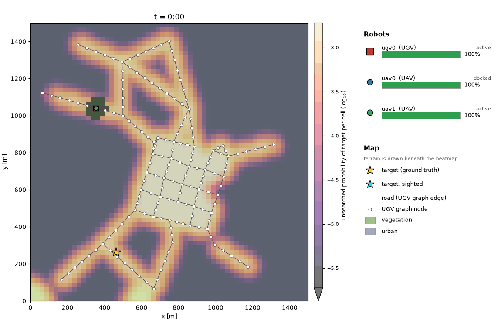

# MarsupialSearch

Development environment for a marsupial multi-robot team concept, consisting of one ground vehicle (UGV: road-bound, long endurance) and two aerial vehicles (UAVs: free motion, short endurance).

The team searches a large area for a stationary target, starting from a prior belief map. One UAV starts docked on the UGV and another starts hovering over it. The dock takes one UAV at a time, and UAVs must plan their battery swaps while the team explores the environment.

Each robot runs its own controller (a *policy*), so the two UAVs can run the same policy or
different ones. A centralised oracle that plans for the whole team is the reference they are
measured against.



*`joint_planner` on the `small` map (1.5 km × 1.5 km) searching for a car, at 30× real time. The heatmap is the target probability not yet searched.
Reproduce with `python scripts/run_mission.py --config configs/small_car.yaml --teams joint_planner`.*

## Contents

- [Quick start](#quick-start)
- [Layout](#layout)
- [1. Problem and simulator](#1-problem-and-simulator)
  - [1.1 Team and mission](#11-team-and-mission)
  - [1.2 Simulator model](#12-simulator-model)
  - [1.3 Visibility layers](#13-visibility-layers-urban-needs-both-robot-types)
  - [1.4 Radio channel](#14-radio-channel)
  - [1.5 Environments](#15-environments)
- [2. Controllers](#2-controllers) (algorithm details in [controllers.md](controllers.md))
  - [2.1 Controller interface](#21-controller-interface-the-deployment-boundary)
  - [2.2 Radio messages](#22-radio-messages)
  - [2.3 Teams](#23-teams)
  - [2.4 Available controllers](#24-available-controllers)
- [3. Benchmarking](#3-benchmarking)
  - [3.1 Running one mission](#31-running-one-mission)
  - [3.2 Experiment files (YAML)](#32-experiment-files-yaml)
  - [3.3 Comparing teams](#33-comparing-teams)
  - [3.4 Results](#34-results)
  - [3.5 Compute and messages](#35-compute-and-messages)

## Quick start

```bash
conda env create -f environment.yml   # creates env "marsupial-search" and installs marsupial_search in editable mode
conda activate marsupial-search
pytest

python scripts/run_mission.py --scenario small --teams joint_planner         # one mission: plots + GIF in outputs/
python scripts/compare.py --scenario small --maps 0 1 2 --teams joint_planner \
    ugv0=ugv_timed_route,uav0=uav_greedy_tour,uav1=uav_greedy_tour           # oracle vs the default team
```

## Layout

```
marsupial_search/
  core/          portable: messages, graph, grid, belief map, controller interface
  controllers/   portable: policies and the oracle (depend only on marsupial_search.core + numpy/scipy)
  sim/           research only: scenario generator, simulator, evaluation
  viz/           research only: matplotlib plots / GIF
configs/         YAML experiment files (example.yaml documents the format)
scripts/
  run_mission.py one mission + plots + GIF
  compare.py     teams x map seeds x target seeds -> CSV + summary + plot
tests/
controllers.md   how each controller works, and how to add one
```

`tests/test_core_and_generator.py` enforces that `marsupial_search.core` and
`marsupial_search.controllers` never import `marsupial_search.sim`, `marsupial_search.viz` or matplotlib.

## 1. Problem and simulator

### 1.1 Team and mission

The fleet is fixed (`FleetConfig` in `marsupial_search/sim/generator.py`); the simulator rejects
any scenario without exactly one UGV.

| | UGV (`ugv0`) | UAVs (`uav0`, `uav1`) |
|---|---|---|
| start | a random non-urban road node | `uav0` docked on the UGV; `uav1` hovering over it |
| motion | road graph only, 5 m/s; road nodes at most 55 m apart (the sensor range) | free, 10 m/s, between nodes of an 85 m UAV grid (√2 × the sensor range: the widest square grid whose footprints leave no gaps) or to any point |
| sensor | 55 m disk; ground and shared layers | 60 m disk; aerial and shared layers |
| energy | 250 000 units; 2.0 /s + 1.0 /m | 2000 units; 1.0 /s (hovering included) + 0.04 /m, so 1.4 /s at full speed |
| endurance | about 10 h of driving (`small` base: 17 000 units, about 40 min) | about 24 min flying (14 km), 33 min hovering |

**The dock** (`DockingSpec`) takes one UAV at a time:

| field | default | meaning |
|---|---|---|
| `dock_duration_s` | 30 s | landing; the UGV must stand still |
| `undock_duration_s` | 15 s | take-off; the UGV must stand still |
| `swap_duration_s` | 120 s | battery swap after landing; the UAV can't take off before it is done |
| `swap_while_moving` | true | false: the swap only progresses while the UGV stands still |
| `dock_tolerance_m` | 3 m | how close the UAV must be to start landing |

Spare batteries are unlimited and cost the UGV nothing. A stay on the dock (landing + swap +
take-off) is about 3 min, during which the other UAV cannot land.

**The mission** ends when the hidden, stationary target is within sensor range of the UGV
(`TARGET_FOUND`). UAVs only report it (`TARGET_SIGHTED`), so a sighting needs the UGV to drive over
and confirm it. Sensors are perfect by default (`p_detect = 1`). A mission also ends when the UGV
is depleted, or at the 6 h limit.

### 1.2 Simulator model

| Aspect | Model |
|---|---|
| Time | fixed step `dt` (default 1 s) |
| UGV motion | along road-graph edges only. A path must start at the current node, a neighbouring node, or an endpoint of the edge being driven. Vegetation has no roads. |
| UAV motion | free: straight lines between UAV-grid nodes or to any point |
| Energy | `idle_power·dt + energy_per_m·distance`, drawn whenever the robot is not docked (UAV hover included). A robot at 0 energy is `DEPLETED` for good. Optional noise on the energy estimate. |
| Docking | UAV within `dock_tolerance_m` of the UGV, which has not moved this step and has its dock free. Landing takes `dock_duration_s`; the dock **aborts** if the UGV moves during it. One UAV at a time. |
| Docked | UAV rides with the UGV and draws no power. Its battery is swapped for a full one in `swap_duration_s`, while the UGV drives or (with `swap_while_moving: false`) only while it stands still. A docked UAV's `mode_time_remaining` is what is left of its swap. |
| Undocking | take-off takes `undock_duration_s`; it **aborts** if the UGV moves during it, and is rejected while the swap is in progress |
| Sensing | disk footprint per robot, sent to the controller each step as a `LocalBeliefUpdate`: a window of per-layer detection probabilities |
| Termination | `TARGET_FOUND` when the target is inside the sensor range of a robot whose type is in `SimConfig.terminate_on` (default: UGV only; perfect, distance-only test). Other robots report `TARGET_SIGHTED`. Other outcomes: `ugv_depleted` (`stop_when_ugv_depleted`, on by default), `all_depleted`, `controller_done`, `timeout`. |

### 1.3 Visibility layers ("urban needs both robot types")

Each cell's probability mass is split across visibility layers (`marsupial_search.core.types.Layer`):

* road / vegetation: 100 % `SHARED` (seen by either type)
* urban: `urban_aerial_fraction` (default 50 %) `AERIAL` (rooftops, courtyards, seen only
  by UAVs) and the rest `GROUND` (street level, seen only by the UGV)

A UAV pass therefore halves an urban cell's mass, and the cell only reaches zero
once the UGV has also passed within range. The belief update is Bayesian:
`mass *= 1 - p_detect` over the footprint.

### 1.4 Radio channel

Robots running their own policies share information only by radio (`SimConfig.radio`,
`marsupial_search/sim/radio.py`). The controller-side API is in [Radio messages](#22-radio-messages).

| `RadioConfig` field | default | meaning |
|---|---|---|
| `range_m` | 2 km for both types | a link needs `distance ≤ min(range[sender], range[receiver])` at send time |
| `latency_s` | 0 | extra delay. Messages always arrive in the next observation at the earliest. |
| `drop_prob` | 0 | independent loss per message and recipient |
| `max_bytes_per_s` | none | per-sender budget; anything over it in a step is dropped |
| `max_payload_bytes` | none | larger payloads are rejected with a `COMMAND_REJECTED` event |
| `simulate_channel` | true | false gives an ideal channel: range, loss, latency, bandwidth and payload limits are ignored, and every message arrives in the next observation |
| `enabled` | true | false turns the radio off entirely (`Transmit` is ignored) |

Depleted robots can't send or receive, even on an ideal channel. Docked UAVs can. There is no acknowledgement
and no multi-hop routing: algorithms that need reliability or relaying re-send messages
themselves. Per-robot counters (`radio_sent`, `radio_received`, `radio_dropped_range`, `radio_dropped_offline`, …)
appear in `robot_stats` and in the run summary. Centralised controllers ignore the radio.

### 1.5 Environments

Environments are generated procedurally by `generate_scenario(ScenarioConfig)` in
`marsupial_search/sim/generator.py`. They are not stored on disk: a map is fully determined by
`ScenarioConfig.seed`, and the target by `target_seed` (or `sample_target`).

A scenario starts from a named **base** (`marsupial_search/sim/scenario_bases.py`; `scenario.base`
in YAML, `--scenario` on both scripts), and any `ScenarioConfig` field can be overridden on top of
it: the map size, towns, road density, prior, fleet or dock. Both bases use the same fleet, and
the same simulator settings (`SimConfig()`).

| `scenario.base` | map | sets (besides the size) |
|---|---|---|
| `large` (default) | 5 km × 5 km, 3 towns | the `ScenarioConfig` defaults |
| `small` | 1.5 km × 1.5 km, 1 town | a smaller town; 15 rural road nodes at least 200 m apart (denser for its size than `large`'s 70); finer roadless regions; a 17 000-unit UGV battery; smaller modes for the optional Gaussian-mixture prior |

A run ends when the UGV finds the target or is depleted (6 h limit). The `small` UGV battery is
sized for about 40 min of driving, so a `small` run either finds the target in time or ends with
`ugv_depleted`.

```yaml
scenario:
  base: small
  n_urban: 2           # two towns on the small map
  n_rural_nodes: 30    # and denser rural roads
```

**Generator.** Terrain has three classes: **road**, **urban** and **vegetation**. Vegetation is
all remaining ground, and the UGV cannot drive on it. The `large` map has 25 m cells, 3 towns
(rotated street grids, 100 m blocks), highways joining the towns, and rural roads (a
relative-neighbourhood graph). Rural roads stay out of smoothed "roadless" regions
(`roadless_fraction`, 30 % of the map) that only highways cross. These leave large stretches of
vegetation that the UGV can't get close to.

#### Prior: lightweight LMPath proxy

[LMPath](https://arxiv.org/abs/2605.13782) builds its prior in three steps. A
language model picks the context labels the target object is found in (a car: road,
parking lot). A segmentation model masks those labels in satellite imagery. The masks
are then summed and normalised: `H = Σ_l M_l / ∬ Σ_l M_l`. The default `prior_model="semantic"`
keeps that structure but replaces the expensive steps:

| LMPath | here (`ScenarioConfig`) |
|---|---|
| language model picks labels | lookup `SEMANTIC_LABELS[target_object]`: `car` → road, urban (default); `building` → urban; `hiker` → road cells next to vegetation, or vegetation within UGV sensor range of the nearest road node. Override with `prior_labels` (names in `generator.LABELS`). |
| SAM segmentation of satellite tiles | the terrain map, with spatially correlated mislabelling (`prior_segmentation_error`, default 10 % of label area, half missed, half spurious, in blobs of `prior_error_blob_m`) |
| sliding-window mask averaging | Gaussian blur of `prior_mask_blur_m` (25 m) |
| sum of masks, normalised | the same, plus a uniform floor `prior_background_weight` (2 %; LMPath has none). The floor lets the Bayesian belief recover where a label was missed. |

It costs a few array operations per map (well under 0.1 s for the `large` map).

**The hidden target is placed uniformly on the *true* label cells** (as LMPath places
its cars), restricted to cells the UGV can get within sensor range of. Under UGV-only
termination, any other target could never be found. The prior is therefore informative
but imperfect: a target can sit in a missed label, and spurious labels attract wasted effort.
`resample_target(scenario, rng)` draws new targets the same way. The old Gaussian-mixture
prior is still available with `prior_model="gaussian_mixture"`.

## 2. Controllers

### 2.1 Controller interface (the deployment boundary)

Algorithms come in two kinds:

```python
class RobotController:                  # a policy: one instance per robot
    def reset(self, robot_id: str, setup: MissionSetup) -> None
    def step(self, obs: RobotObservation) -> Command | list[Command] | None
    def is_done(self) -> bool

class MissionController:                # centralised: the whole team at once
    def reset(self, setup: MissionSetup) -> None
    def step(self, obs: Observation) -> dict[str, Command | list[Command]]
    def is_done(self) -> bool
```

* **Policies** (`RobotController`) are the normal case. A `RobotObservation` holds only what
  one robot knows by itself: its own `RobotState`, its own sensor updates, events involving
  it, and its radio `inbox`. Other robots' positions, plans, visited nodes and sightings must
  arrive by radio. In simulation, `DecentralizedTeam` runs one isolated controller per robot
  (each with its own deep copy of the `MissionSetup`) and stops stepping robots that are
  depleted. On hardware, each robot runs its `RobotController` directly.
* **Centralised** (`MissionController`) sees every robot's state and sensor data
  instantly and ignores the radio. The oracle is of this kind: a reference with perfect,
  free, unlimited-range communication.

The data passed across the boundary:

* `MissionSetup` (once at start): grid, terrain, global prior, visibility-layer
  split, traversability graphs per robot type, robot specs (speed, energy model,
  sensor), docking parameters and `radio_range_m` (so controllers can plan to stay connected).
* `Observation` (every step): `RobotState` per robot (position, mode, energy
  estimate, current or last graph node, nodes reached this step, remaining path,
  dock relationships), the `LocalBeliefUpdate`s from each sensing robot, and
  events (docked, dock aborted, depleted, target sighted/found, command rejected, …).
* `Command`: `FollowPath(nodes)`, `GoToPoint(xy)` (free-motion robots only),
  `Hold()`, `Dock(ugv_id)`, `Undock()`, `Transmit(topic, payload, to=None)`. A robot
  can be given a list of commands, e.g. a motion command plus radio messages.

On hardware, an adapter (e.g. a ROS node) builds the same `Observation` from
localisation, battery and perception topics, and turns `Command`s into motion
goals, dock requests and radio transmissions. The controller code does not change.

### 2.2 Radio messages

```python
cmds["uav0"] = [FollowPath(path), Transmit("claims", {"node": 42, "utility": 0.7})]          # broadcast
cmds["ugv0"] = Transmit("rendezvous", Rendezvous(xy=(1200, 800), eta_s=95.0), to=("uav1",))  # unicast
...
for msg in obs.inbox("uav1", topic="claims"):   # RadioMessage: sender, topic, payload, recipients,
    handle(msg.sender, msg.payload)            # sent_time, received_time, size_bytes, seq
```

* The payload is algorithm-defined: a dict, a dataclass, numpy arrays, bytes, or anything
  the codec can serialise. `topic` is a free-form channel name that algorithms use to route messages.
* Each transmission is encoded once, which sets its size for bandwidth accounting, and
  decoded separately for each recipient. Robots never share mutable objects. The default
  `PickleCodec` (`marsupial_search/core/radio.py`) can be swapped for msgpack, protobuf or ROS messages
  on hardware.

How messages are delivered (range, loss, bandwidth) is set by the [radio channel](#14-radio-channel).

### 2.3 Teams

A mission is run by a *team*, which is controlled by either:

* **a policy per robot**: `{ugv0: ugv_timed_route, uav0: uav_greedy_tour, uav1: uav_greedy_tour}`
  (the default team). A policy's name starts with the robot type it is for (`ugv_` / `uav_`), and
  assigning one to the wrong robot fails. Giving both UAVs the same policy is the shared-policy case.
* **a centralised controller** that commands the whole team, such as the oracle `joint_planner`.

On the command line and in YAML, a per-robot team is written as `robot=policy` pairs
(`ugv0=ugv_timed_route,uav0=uav_greedy_tour,uav1=uav_greedy_tour`) and a centralised one by its
name. Results label a team by its policies, UGV first (`ugv_timed_route+uav_greedy_tour+uav_greedy_tour`),
and print its kind (centralised or decentralised).

### 2.4 Available controllers

| name | kind | for | idea |
|---|---|---|---|
| `ugv_timed_route` | policy | UGV | commits to a timed road route; UAVs book landings on it |
| `uav_greedy_tour` | policy | UAV | books the next landing slot on that route and flies a greedy tour to it |
| `joint_planner` | centralised **oracle** | the whole team | plans the UGV route, the dock schedule and both UAVs' tours jointly, over a horizon, with perfect information |

The two policies share the dock through a booking protocol (`dock_booking.py`): the UGV commits to
a timed route, and each UAV books a landing on it before take-off, so a sortie needs no radio in
flight. A new UAV heuristic only has to plan its own sortie on that route.

[controllers.md](controllers.md) describes each controller and the protocol, and how to add a new
one. `python -m marsupial_search.sim.config_io` lists every controller parameter with its default.

## 3. Benchmarking

### 3.1 Running one mission

```bash
python scripts/run_mission.py --scenario small --teams joint_planner --seed 0 --target-seed 7
python scripts/run_mission.py --teams joint_planner ugv0=ugv_timed_route,uav0=uav_greedy_tour,uav1=uav_greedy_tour
python scripts/run_mission.py --no-animate      # skip the GIFs (faster)
python scripts/run_mission.py --gif-speedup 20  # GIF playback: 20 mission seconds per GIF second
python scripts/run_mission.py --no-terminate    # ignore the target; run to full coverage
```

It runs each team once on the same map and target, so their plots can be compared side by side.
Without `--teams` it runs the experiment file's `teams` (default: `joint_planner` and the default
team). It writes to `outputs/` (`--out`): the map (`<map>_map.png`), a plot and GIF per team
(`<map>[_t<target seed>]_<team>.png` / `.gif`) and the resolved settings
(`<map>[_t<target seed>]_config.yaml`). Here `<map>` is the base scenario and map seed, e.g. `small_s0`.
GIFs play at 10 frames per second. By default each frame covers 1/150 of the mission (10–60 s),
i.e. 100–600× real time; `mission.gif_speedup` (or `--gif-speedup`) sets the speed instead.

### 3.2 Experiment files (YAML)

Both scripts take `--config file.yaml`. Settings are resolved in this order: the base
scenario and `SimConfig()` defaults, then the file, then any command-line flag you pass explicitly. Settings both scripts
use are at the top level, and each script's own settings are in its section (`mission:` for
`run_mission.py`, `compare:` for `compare.py`). `teams` is what runs, in both scripts.

```bash
python scripts/run_mission.py --config configs/small_hiker.yaml
python scripts/compare.py     --config configs/small_hiker.yaml
python scripts/run_mission.py --config configs/example.yaml --seed 3   # the flag wins
python -m marsupial_search.sim.config_io --scenario small              # every settable key + default
```

```yaml
teams:                       # what runs, in both scripts
  - joint_planner
  - {ugv0: ugv_timed_route, uav0: uav_greedy_tour, uav1: uav_greedy_tour}
controller_params: {uav_greedy_tour: {plan_lead_s: 45}}   # per policy: applies to every robot running it
out: outputs/my_experiment
scenario:
  base: small                # large: 5 km x 5 km, 3 towns | small: 1.5 km x 1.5 km, 1 town
  target_object: hiker       # then any ScenarioConfig field (marsupial_search/sim/generator.py)
  fleet: {uav_energy: {capacity: 2500, idle_power: 1.0, energy_per_m: 0.04}}
  docking: {swap_duration_s: 180, swap_while_moving: false}
sim:                         # any SimConfig field (marsupial_search/sim/simulator.py)
  terminate_on: [ugv]
  radio: {range_m: {uav: 1500}, drop_prob: 0.05}

mission:                     # run_mission.py only
  seed: 0                    # map seed
  target_seed: 7             # resample the hidden target (optional)
  animate: true              # a GIF per team
  gif_speedup: 20            # GIF playback: mission seconds per GIF second (optional)
compare:                     # compare.py only
  maps: [0, 1, 2]            # map seeds
  targets: 2                 # missions per team and map (default: 2 for cv, 10 for plain)
  estimator: cv              # see "Comparing teams"
  workers: 8
```

`configs/example.yaml` documents every key.

* A key in the wrong place fails with where it belongs, e.g. `seed` under `compare:`. Files in
  the older layout (`preset` or `env_size`, `team`, a top-level `seed` or `maps`) fail the same way.
* Nested sections are partial overrides. `fleet: {uav_speed: 12}` keeps the base's other
  fleet values, and dicts such as `radio.range_m` are merged.
* Values are converted from the config dataclasses' type annotations: lists become tuples,
  and names become enums (`ugv`, `road`). A misspelt key or wrong type fails immediately,
  with the path and the valid keys.
* Each run writes its fully resolved settings next to its outputs: `<map>[_t<target seed>]_config.yaml`
  for `run_mission.py`, `config.yaml` for `compare.py`. These files can be passed back in with
  `--config` to reproduce the run.

### 3.3 Comparing teams

`compare.py` runs every team on the same map seeds (`compare.maps`, default 0–4) and estimates each team's
**expected time to find**, counting a mission that never finds the target at its end time. In the
summary, `±` is the standard error over maps, and each team is also compared with the first one,
paired by map. It writes `maps.csv` (one row per team and map), `runs.csv` (one row per mission),
the resolved `config.yaml` and a `time_to_find.png` plot to `outputs/compare_<base>` (`--out`).

There are two estimators (`compare.estimator` / `--estimator`):

* **`cv`** (default): per team and map, one *target-free* run (`SimConfig.target = False`) and
  `targets` real missions (default 2). Until a robot first gets within sensor range of the target,
  nothing any robot observes depends on where the target is, so every mission follows the
  target-free run's trajectory up to that moment. From that one run, `marsupial_search/sim/evaluation.py`
  predicts the find time `T̂` of every possible target: exactly when the UGV reaches it first, and
  as the sighting time plus the UGV's drive when a UAV sights it first. The estimate is
  `E[T̂] + mean(T − T̂)`: the prediction averaged over the whole target distribution, corrected by
  its error on the real missions. It is unbiased whatever the quality of `T̂`, and because
  `T − T̂` varies far less than `T` (0.1–9 min against 3–40 min), 2 missions per map do the work of
  20 or more. Median, p90 and the plot come from the predicted distribution.
* **`plain`**: the mean over `targets` missions per map (default 10). Everything reported comes
  from missions that actually ran.

**Which to use.** `cv` for comparing mean time to find, which is what the results below report.
The summary's `sd(T-T̂)` column shows how well it is working: the smaller it is against the spread
of `T`, the more `cv` gains. Use `plain`, or `cv` with more `targets`, when:

* you need the distribution of real outcomes: found rates, outcome counts (depletions, timeouts)
  or real quantiles, which `cv` only has from 2 missions per map;
* the prediction is poor (`sd(T-T̂)` close to the spread of `T`), for example a team that is slow
  to confirm sightings;
* the target-free run no longer replays the missions up to first contact: imperfect sensors
  (`p_detect < 1`), energy-estimate noise, or controllers that randomise. `cv` stays unbiased but
  removes less variance;
* you are checking `cv` itself: run both on the same maps and compare the means.

```bash
python scripts/compare.py --scenario small --maps 0 1 2 3 4 --estimator cv
python scripts/compare.py --scenario small --maps 0 1 2 3 4 --estimator plain --targets 10
```

### 3.4 Results

All results use the semantic `car` prior, 120 s battery swaps with the UGV free to drive during
them, UAVs flying at 10 m/s, and a 300 m radio range for every robot. Missions are reproducible
from their seeds. Expected minutes to find the target (`cv` estimator: per team and map, one
target-free run and 2 missions), ± the standard error over 5 maps; median and p90 are predicted
over every possible target. Commands:

```bash
python scripts/compare.py --config configs/large_car.yaml
python scripts/compare.py --config configs/small_car.yaml
```

| map | team | expected | median | p90 | vs `joint_planner` (paired by map) |
|---|---|---|---|---|---|
| `large` | `joint_planner` | **56.4 ± 3.7** | 45.8 | 113.5 | |
| `large` | `ugv_timed_route+uav_greedy_tour+uav_greedy_tour` | 75.6 ± 5.9 | 57.7 | 135.4 | +19.2 ± 4.3 |
| `small` | `joint_planner` | **6.7 ± 0.8** | 5.6 | 13.6 | |
| `small` | `ugv_timed_route+uav_greedy_tour+uav_greedy_tour` | 9.9 ± 1.8 | 6.5 | 15.5 | +3.3 ± 1.7 |

Every mission found the target; no UAV was lost and no landing or take-off aborted.

- **Joint planning is worth about 19 min on `large`** against the per-robot policies, and its
  tail is shorter (p90 114 against 135 min). The oracle needs no radio, so part of the gap could
  be information; but the default team is no faster with the default 2 km range (79.7 ± 6.0 min
  on `large`, 9.9 ± 1.8 on `small`), so the gap is mostly planning.
- **The default team copes with a short radio range.** At 300 m it receives about a quarter as
  many messages as at 2 km on `large` (63 k against 244 k), with no loss in time to find: a
  sortie's landing is agreed before take-off, so it needs no radio in flight.
- **The greedy-belief baseline** that `joint_planner` replaced (perfect information, one leg of
  look-ahead) was last measured with the earlier fleet (15 m/s UAVs, fixed 80 m UAV grid and
  50 m road nodes, 2 km radio): 61.4 ± 6.2 min on `large`, 12 min slower than `joint_planner`
  then (49.5 ± 3.0), and 5.3 ± 0.5 on `small`, 0.2 min faster (`small` missions end within
  minutes, before a planned sortie pays off).

### 3.5 Compute and messages

- Per simulated second, on an Apple-silicon Mac: the default team 0.3–0.7 ms for the whole team;
  `joint_planner` 13 ms on average, nearly all of it in re-plans (1000 search iterations, 1–2 s
  each, every 2 min and after every dock event).
- An average message is about 2 kB on `large` (status broadcasts and bookings). The largest is
  the belief map a landed UAV sends the UGV: 3 layers of 200 × 200 float32 cells, 480 kB. It goes
  to a UGV a few metres away, but a real link would want it compressed or sent as a diff.
