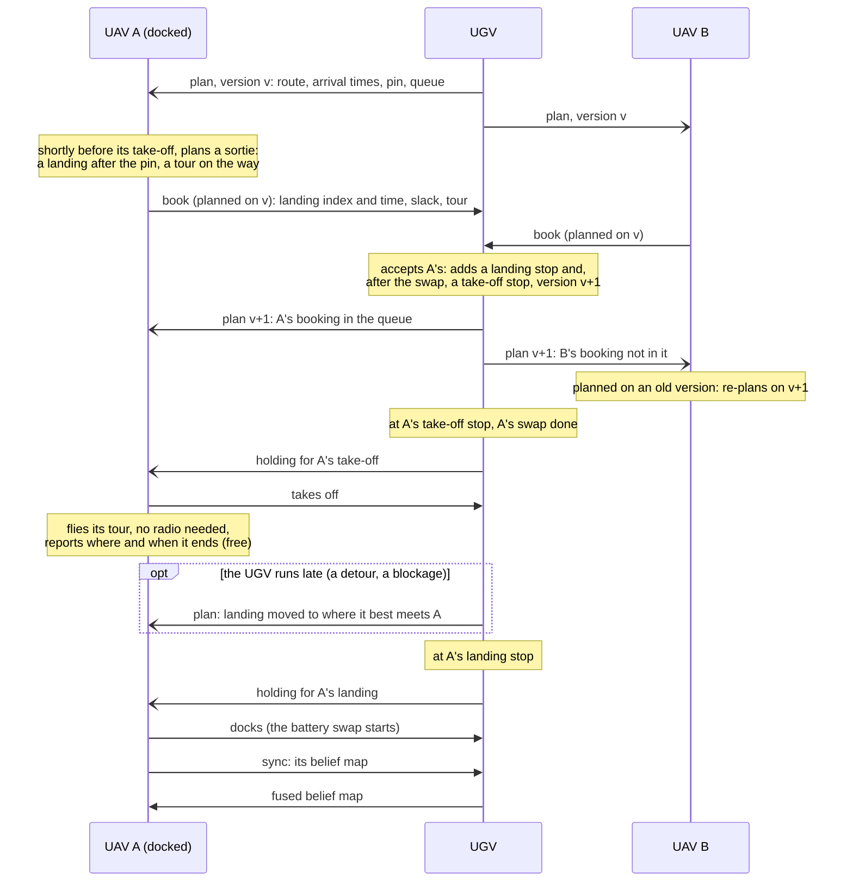
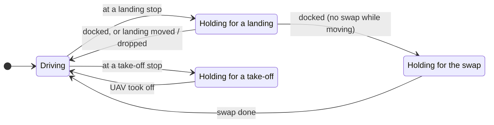
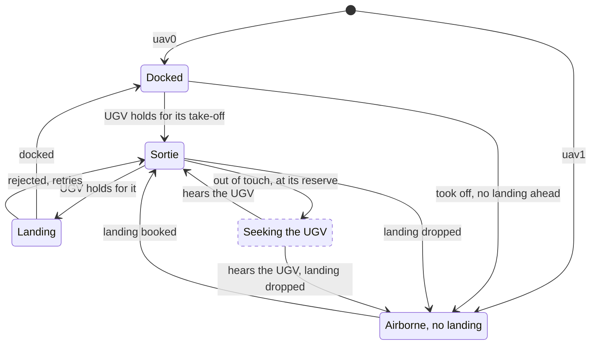
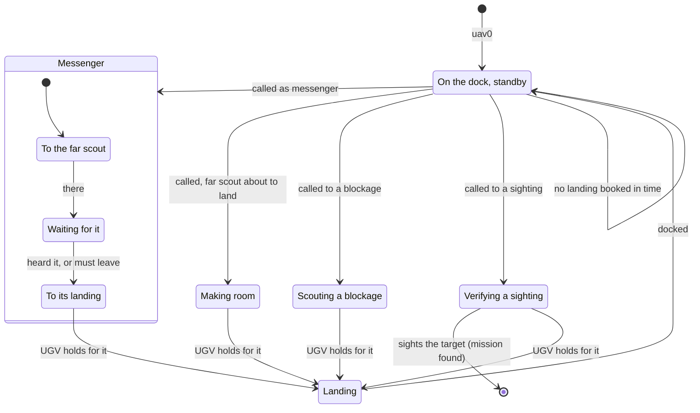
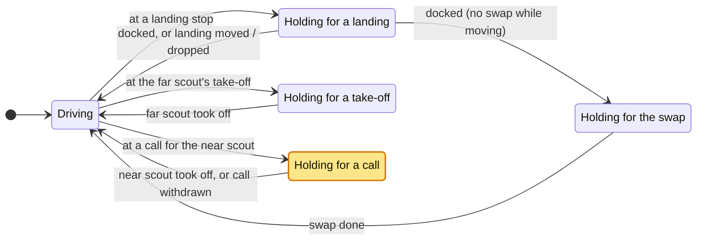

# Controllers

How the controllers in `marsupial_search/controllers/` work. The interface they implement, and
how they are combined into teams, are in the [README](README.md#2-controllers).

| name | kind | for | idea | file |
|---|---|---|---|---|
| `ugv_timed_route` | policy | UGV | commits to a timed road route; UAVs book landings on it | `ugv_timed_route.py` |
| `ugv_ctp_route` | policy | UGV | `ugv_timed_route`, planning its way on the road as a Canadian Traveller's Problem (`road_planner: ctp`) | `ugv_timed_route.py`, `ctp.py` |
| `uav_greedy_tour` | policy | UAV | books the next landing slot on that route and flies a greedy tour to it | `uav_greedy_tour.py` |
| `uav_near_scout` | policy | UAV | flies low, on standby on the dock: the UGV calls it to make room for another UAV's landing, to scout a blocked node, as a messenger to a UAV out of touch, or to verify a sighting the UGV cannot reach | `uav_near_scout.py` |
| `uav_far_scout` | policy | UAV | flies high, searching the wider area on sorties it books itself (for now as `uav_greedy_tour`) | `uav_far_scout.py` |
| `joint_planner` | centralised **oracle** | the whole team | plans the UGV route, the dock schedule and both UAVs' tours jointly, over a horizon, with perfect information | `joint_planner.py` |

Shared building blocks: `common.py` (search settings, sensor footprints, pursuit paths),
`core/relay.py` (each robot's latest status passed on to robots out of its range; see the
[README](README.md#22-radio-messages)),
`sortie_planner.py` (UAV energy model, greedy road routes and chain tours), `dock_booking.py`
(the protocol the two policies speak) and `ctp.py` (road paths that weigh the risk of blockages
not yet seen).

**What they optimise.** All of them score a place by the same quantity: the target probability
(*belief*) still left inside a sensor footprint there, each layer weighted by the chance a look
detects it. The UGV sees the ground and shared layers; a UAV sees the aerial and shared layers,
and street level with probability `fleet.uav_ground_p_detect` (default 0; see
[Visibility layers](README.md#13-visibility-layers-urban-needs-both-robot-types)). Only the UGV can
end the mission, so a UAV sighting is worth something only once the UGV drives over to confirm it,
unless the near scout's own sighting ends it (`sim.confirm_by: [uav0]`): then it can verify a
sighting the UGV cannot reach (`ugv_timed_route`, *verifying a sighting*).

**What constrains them.** The dock shapes every plan. A UAV that is not docked has nowhere to wait
except in the air, and a stay on the dock takes landing + swap + take-off (about 3 min), during
which the other UAV cannot land. The numbers are in
[Team and mission](README.md#11-team-and-mission).

## Decentralised policies

### Dock booking (`dock_booking.py`): how the UAVs share the dock

The UGV and UAV policies speak a small protocol. **The UGV only plans and commits to its own
route, and each UAV picks its own stretch of that route and plans its tour on it.** A sortie
⟨i, j…, k⟩ takes off from the UGV at road node i, visits points j…, and lands at a later road
node k agreed before take-off (Murray and Chu's flying sidekick TSP, with an orienteering
objective). Because the landing point and time are fixed in advance, **a sortie needs no radio in
flight**.

1. **The UGV commits to a route.** Positions along it are *route indices*, and the UGV broadcasts
   the route with its arrival time at each one.
2. **Stops are promised on the route.** A booking adds a *landing* stop and, after that UAV's
   battery swap, a *take-off* stop. A stop starts at `max(arrival, ready)`: an early UGV waits, and a late
   one delays everything after it. The UGV holds at a stop and announces `holding` until the dock
   or undock is complete. The last route index with a promised stop is the *pin*. The route up to
   the pin never changes.
3. **A UAV books a landing** after the pin, shortly before it takes off, or at once if it is
   airborne without a booking. The booking names the landing index and time, the energy it
   expects to land with, its hover slack, and its tour (other UAVs skip those nodes).
4. **The UGV accepts or refuses.** It accepts a booking planned on its current route *version*
   that lands after the pin. Accepting adds the two stops and bumps the version, so other bookings
   planned on the old route are refused and those UAVs re-plan. Bookings only ever append, so an
   accepted booking is never moved by a later one.
5. **Flight and landing.** The UAV takes off when the UGV holds for it, flies its tour (cutting it
   short if its energy margin requires), and docks when the UGV announces it is holding there for
   it. Once its tour is done, it flies straight to a UGV that holds for it, wherever that is.
   In flight it reports in its status where and when its tour ends and the energy it can spend
   after that (`free`), so a late UGV can meet it elsewhere (see the recovery below). Out of
   radio contact, it waits at its landing node (with no radio at all, it tries to land once the
   UGV is due), until it is down to the energy it keeps in reserve (`uav_reserve_fraction`): the
   UGV has not come in the time it could afford, perhaps because a blockage sent it the long way
   round and the UAV never heard the new plan. With `seek_ugv` it then goes to look for the UGV:
   back along the UGV's last planned route from its landing node, in steps of half a radio
   range, then to where it last heard the UGV. Once it hears the UGV again, it flies to its
   landing, wherever the UGV has it now (or books again if the UGV gave up on it). That is off
   by default: on `large` with blockages that cut off parts of the network, it did not save UAVs
   (at its reserve it has about 1 km of flight left, and the UGV was usually 1 to 1.6 km away on
   its detour), and without it the UAV keeps waiting. Leaving earlier, once past its landing time
   and slack, was tried too: better on one map, worse on another. After
   landing, it swaps belief maps with the UGV (`sync`), so the next tour includes what the other
   UAV reported.

One sortie of UAV A, with UAV B booking at the same time. Open arrows are the `"status"` each robot
broadcasts every step (the UGV's carries its `plan`), filled ones are messages to one robot
(`"book"`, re-sent until it shows up in the queue, and `"sync"`); "takes off" and "docks" are the
UAV's own commands. A refused booking gets no reply: the UAV sees the plan's version change and
plans again.



With `swap_while_moving: false` the UGV also holds at a landing stop until the swap is done.

**Relaying** (`relay`, on by default). Each robot passes on the other robots' latest `"status"`
(`core.Relay`: versioned by when its origin sent it, with a vector clock in every broadcast, so a
robot sends only what a neighbour lacks by more than `relay_period_s`, 5 s). A UAV out of the
UGV's range thus hears its plan through the other UAV, at once or when that UAV gets to it, and
the UGV hears that UAV's status the same way. A relayed status counts like one heard directly:
a robot is *in touch* if the status it holds was sent within 10 s (`partner_stale_s`,
`uav_stale_s`). A relayed status leaves out that step's belief updates and road nodes reached
(applying a belief update twice would count it twice); bookings and belief syncs are never
relayed.

*Why.* With blockages that send the UGV the long way round, its new plan moves the landings, and
a UAV out of the 300 m radio range never heard it: it waited where it had booked and ran flat.
Relaying is meant to be as simple as possible, as it is not the subject of this project. The
period exists because the UGV's status changes every step: without it, a robot would forward the
UGV's whole plan to a neighbour every step. Bookings stay direct because the UGV only accepts one
planned on its current plan version, which a relayed booking would often have missed. A direct
status's belief updates are applied even when a newer relayed copy of that robot's state came
first. With three robots and a 300 m radio, few UAVs are reachable through another, so it saves
some UAVs, not most (on 40 large maps with cut-offs, 27 lost against 24 with `ugv_timed_route`, 28
against 22 with `ugv_ctp_route`).

**Standby UAVs.** A UAV whose status says `standby` (`uav_near_scout`) does not book sorties of its
own: it stays on the dock until the UGV *calls* it, with a take-off stop marked as a call in the
plan (`calls`). The UGV calls it in three cases:

- *To make room.* Another UAV is about to land while it is on the dock (the dock takes one UAV):
  its take-off goes right before that landing, timed to end just as the other UAV lands. It leaves
  whether or not its own landing is booked.
- *To search what a blockage cuts off.* The UGV's route runs into a blocked node within
  `call_radius_m` (250 m) of the UGV. The road nodes it *cuts off* are those within `call_reach_m`
  (500 m) of the UGV by road on the map before, that are now `call_gain_m` (200 m) further away by
  road, or out of reach. The UGV calls the standby UAV (if its battery is swapped) only if the
  belief that UAV can see round them (the UGV's footprint at each) is at least `call_min_belief`
  (0.005), round nodes out of reach counting `pocket_weight` (2) times. Belief already searched by
  any robot is gone from the UGV's map, so ground that has been looked at calls nobody. The call
  lists the cut-off nodes; the UAV takes off where the UGV is, once it has booked its landing (a
  call it has not booked within `call_timeout_s`, 15 s, is withdrawn). The generated maps keep the
  roads connected round blocked nodes (unless `road_cutoff_fraction` lets blockages cut off part of
  the network), so there a blockage only makes the way longer.
- *As a messenger* (`messenger`, with `relay`). The UGV can no longer meet a UAV in time where it
  waits, and that UAV is out of radio contact, so it never hears the new plan: typically a blockage
  sent the UGV the long way round. If the standby UAV is on the dock (its battery swapped within a
  minute), the UGV calls it to fly to that point (`deliver`). Its other take-offs go, and the
  take-offs pull back, so the dock is free as early as it can be when it books its landing. It
  flies to the UAV-grid node nearest the point and waits there until it hears the other UAV
  (relaying hands over the UGV's plan, and brings that UAV's status back), or until it must leave
  to land on time; its landing leaves it `deliver_wait_s` (180 s) there. If it could not land
  anywhere in time, it books nothing and the call is withdrawn (not repeated for that landing).
  From the moment the messenger should get there, the UGV plans to meet the other UAV as if in
  touch: anywhere on its route that UAV can afford, not only within radio range of where it waits.

  *Why.* With the scout team on 20 large maps with cut-offs (relaying on), the far scout was lost
  in 7 of 40 missions, each time after one put-back of its landing by 5 to 8 min while it was out
  of touch. Put-backs beyond its slack were common (116) but the short ones were nearly always
  survived, so the trigger is the UGV finding no meeting the UAV can afford, not any put-back. At
  those moments the near scout was on the dock and could get there in time in 6 of 7. The UGV
  re-plans the meeting as if in touch before the messenger leaves, or the messenger would carry a
  landing the UAV still could not afford. The rest came from testing:
  - *Its other take-offs go, and the take-offs pull back.* At first the messenger booked a landing
    41 min ahead: an old take-off of its own (to make room for that same UAV's original landing)
    kept that UAV's take-off far down the route, so the dock looked taken until then.
  - *No landing in reach, no sortie.* It used to book the first free landing anyway; in flight its
    energy check then dropped the leg to the other UAV at once (it could not hover until that
    landing), and it flew straight to its landing. On one map that lost a far scout that survived
    without a messenger.
  - *Not repeated for that landing.* The UGV holds at the call (up to 15 s) while the standby UAV
    tries to book; calling again and again would stall it.
  - *It waits at the point.* The other UAV may still be on its tour; flying past would miss it.

  On 40 large maps with cut-offs it cut the UAVs lost from 18 to 6 ([results](README.md#34-results)).

A called UAV books its landing wherever the dock is free, not only after the pin: the plan lists
the route indices each UAV is on the dock (`busy`). The UGV adds no take-off after that landing.
The other UAVs keep booking after the pin, and once their battery swap is done (`free_from`);
they don't book while a standby UAV is in the air without a landing. With a standby UAV, the
landing slots are shared by the other UAVs only.

`BookingUav` implements the UAV side (booking, take-off, flight, landing, sync). A UAV policy
subclasses it and implements one method, `plan_sortie`, which picks the landing and the tour.

### `ugv_timed_route`

Plans its road route greedily (chaining the best `belief in footprint / (distance + 100 m)`
within 1.5 km, else the nearest road node with belief left) and keeps it planned
at least one landing slot per UAV, plus one, plus a full UAV flight ahead. After the pin, the
route is re-planned on the current belief every 60 s.

- *Sightings:* the UGV detours at once, from the node it is at or driving to, if no UAV still
  to land would wait past its hover slack (60 s). Otherwise it goes straight after the pin, and
  checks the detour again at every node it gets to (and once a stop there is done) while a stop
  still comes before the sighting.
- *Verifying a sighting* (`verify`). With a standby UAV whose sighting ends the mission
  (`MissionSetup.confirmers`: the near scout with `sim.confirm_by: [uav0]`), a sighting the UGV
  cannot get within sensor range of on its road map (in a part of it blockages cut off, or off
  the road) is verified from the air. The UGV's pursuit goes to the road node it can reach that is
  nearest the sighting, and there it calls the near scout to fly to the sighting itself. If a
  blockage found on the way makes the drive to the end of its pursuit `verify_detour_m` (300 m)
  longer, or cuts it off, the UGV calls it at once from the node it is at or driving to, if that
  is within `verify_radius_m` (500 m) of the sighting; farther away, it drives round as before. A
  near scout away from the dock is called once it is back, if the UGV is still that close (else
  the UGV drives back); a call it books no landing for is withdrawn and not repeated at that node.
  On the line map with the road cut 150 m before the target (`tests/test_scouts.py`), the near
  scout confirms it 21 s after it takes off, in each of the three missions there.
- *A missing UAV:* the UGV drops a landing 120 s after the UAV's slack runs out, or 120 s after a
  landing that started should have ended (the UAV ran out of energy on the way down: it sends
  nothing more).
- *Recovery (a landing the UGV can't make):* when the UAV can no longer afford to wait for the UGV
  at its landing node (from the energy and tour end it reports, or as booked), when that node turns
  out to be blocked, or when after a re-route the UGV would get there more than `recover_gain_s` (60
  s) late, the UGV moves the landing to where it best meets the UAV: any node of its route between
  the stops around it, or of the shortest way to the landing node (it then skips the route in
  between). The best meeting lands the UAV soonest with the least waiting by the UGV, among those
  the UAV can afford to fly to. The take-off follows to the first node the UGV reaches once the
  battery is swapped. A landing moved onto its own take-off's index goes before it: a re-route that
  skips both can put them on one index, and with the take-off first the UGV waited for good for a
  UAV not yet on the dock (on `large` with a mismatch, map 0 timed out with both planners until this
  was fixed). A UAV out of touch (no status for `uav_stale_s`, 10 s, direct or relayed) is only met
  within radio range of the end of its tour, where it waits, so it hears the UGV arrive; if no
  meeting there is affordable, the UGV may send a standby UAV as a messenger (see standby UAVs
  above), and from when it should get there plans to meet that UAV as if in touch. Two other answers
  to a UAV out of touch were tried and dropped. A detour by the UGV to within radio range of where
  the UAV waits was mixed in tests: it saved both UAVs in one mission and lost both in two others
  that had lost none. A backup rendezvous agreed before take-off, on a node the UGV had already
  driven (sure to be passable), would have saved 1 of 20 UAVs lost if it were the sortie's take-off
  node, and 4 had every sortie kept 10 % of its battery for it: by the time the UGV is overdue, the
  UAV is at its reserve, and the UGV was 0.4 to 5 km by road from that take-off node.



The UGV holds at each stop until it is done; the re-planning above (route, sightings, blockages,
recovery) goes on in any state, and the mission ends once the target is within its sensor range.
`ugv_ctp_route` has the same states. With a standby UAV on the team, it has one more (see
[`uav_near_scout`](#uav_near_scout-and-uav_far_scout)).

### `uav_greedy_tour`

1. **Landing slot (the split).** It aims to land `slot_s` after the last booked landing:

   ```
   slot_s = max(R, (S + R) / n_uavs)      S = full sortie, R = dock + swap + undock
   ```

   With 120 s swaps, `S ≈ 1290 s` and `R ≈ 170 s`, so the slots are about 730 s apart. If it can't reach that
   landing node in time, the UAV takes the latest earlier one it can. The UAVs therefore land in
   turn, each searching the stretch between its take-off and its landing. With
   `max_landing_risk` below 1 (off by default), it only considers landings that the UGV's plan
   (`ugv_ctp_route`'s `clear`, see [road-map mismatch](#road-map-mismatch)) says it gets to with no
   long detour, with at least 1 − that chance.
2. **Tour.** A greedy chain to the landing node, arriving no later than the UGV: the next node has
   the best `belief / (distance + 100 m)` among those that still leave range to reach the landing.
   It skips nodes in the other UAV's booked tour, and counts shared belief only where it gets there
   before the UGV's route.
3. **Out of touch:** it flies to where it last heard the UGV and books again.

It assumes both UAVs have its speed and battery (`slot_spacing`); their sensors may differ.



Both UAVs of the default team run it: `uav0` starts docked, `uav1` hovering over the UGV. The
transitions are the steps of [dock booking](#dock-booking-dock_bookingpy-how-the-uavs-share-the-dock);
the dashed state is off by default (`seek_ugv`). A UAV whose battery runs out is lost, whatever
its state.

### `uav_near_scout` and `uav_far_scout`

A pair of roles for a low and a high UAV: give the near scout the smaller sensor
(`fleet.uav_sensor_ranges`, e.g. `{uav0: 20, uav1: 50}`). With the near scout mostly on the dock,
the team searches with the UGV and one UAV most of the time.

**`uav_far_scout`** flies high and searches the wider area on sorties it books itself, taking
every landing slot. It plans as `uav_greedy_tour`, on the belief weighed to complement the UGV and
the near scout, and has its states (diagram above). The UGV's route here is the stretch it drives
during one full sortie.

| option | what it does | default | effect (near + far scout team, `cv`, paired by map) |
|---|---|---|---|
| `near_route_m`, `near_route_weight` | belief near the UGV's route counts less: 0.25 on it, rising to full at 300 m (the UGV sweeps it, and the near scout searches there while the far scout is on the dock) | on, 300 m | −13.5 ± 8.0 min on 30 large maps with road mismatches (faster on 19); −1.5 ± 1.4 min on 10 small ones |
| `recon_weight`, `recon_from_s`, `recon_to_s` | once a blocked node is known, each road node on the UGV's route 2–30 min ahead that no robot has looked at is worth that many average footprints of belief | off | +0.7 ± 9.0 min (10 large maps), none on small |
| `confirm_scale_s` | belief counts τ / (τ + d), d the UGV's drive from its route to confirm a sighting there | off | +1.2 ± 12.1 min (10 large maps), none on small |

With all three on, the gain drops to −6.1 ± 8.0 min (30 large maps). New scores for picking the
next tour node go in `uav_far_scout.py` (`_tour_mass`).

**`uav_near_scout`** is a standby UAV (see dock booking above) that flies low, next to the UGV:

1. **Making room.** It lands at the first route index where the dock is free (after the other
   UAV has left it) and that it can reach. Its tour is the `uav_greedy_tour` chain tour, on
   UAV-grid nodes within `nearby_m` (300 m) of the UGV's route from its take-off to its landing.
2. **Called to a blockage.** It first syncs its belief with the UGV's, so it knows everything
   any robot has searched. Its tour is the chain tour on UAV-grid nodes within `scout_radius_m`
   (75 m) of the cut-off road nodes, picking each next node by the belief left in its footprint,
   so nothing already searched. It lands at the first route index, from `scout_min_s` (60 s) on,
   by which that tour sweeps `cover_fraction` (90 %) of what the longest one it may fly
   (`scout_max_s`, 600 s) would: as soon as it has covered them.
3. **Tracing roads** (`trace_roads`). Called to a blockage, it follows any road it finds that is
   missing from the map: it flies to the far end of each new road node it sees (within
   `trace_radius_m`, 200 m, of the blocked node), dropping tour nodes from the end as needed to
   land on time with its reserve. It reports what it finds like any UAV, so the UGV uses those
   roads from its next re-plan.
4. **As a messenger** (`deliver`). Its tour is one UAV-grid node, the nearest to where the other
   UAV waits; it lands at the first route index that leaves it `deliver_wait_s` (180 s) there
   (else the first it can reach, and if it can reach none, it books nothing and stays on the
   dock). At that node it holds until it hears the other UAV directly (relaying then hands over
   the UGV's plan, and carries that UAV's status back), or until it must leave to land on time.
5. **To verify a sighting** (`verify`, when its sighting ends the mission). It flies to the
   sighting itself (booking the UAV-grid node nearest it as its tour), then lands at the first
   route index it can reach in time; if it can reach none, it books nothing and stays on the dock.

Each time, it lands only where the dock is free, and early enough that its battery is swapped
before the other UAV's next landing.



A call to a blockage, as a messenger or to verify a sighting is withdrawn if it books no landing within
`call_timeout_s` (15 s); called to make room, it leaves either way and books from the air.

With a standby UAV on the team, the UGV holds at a call (highlighted) as at any take-off, until
the near scout has left or the call is withdrawn:



## Oracle: `joint_planner`

The reference the per-robot policies are measured against: it sees everything at once *and*
plans better, by optimising one plan for the whole team over a horizon of several sorties
(`horizon_s`, 45 min). It plans on the belief, never on the true target.

- **Plan.** The UGV's road route; the dock schedule (each visit a landing and a take-off at route
  indices, one UAV docked at a time); and a tour of UAV-grid nodes for each sortie. The last
  sortie may stay open, if the UAV could still reach the UGV and land once the dock can be free.
- **Timeline.** One pass over the dock events: the UGV waits at a landing until the UAV is there,
  and at a take-off until that UAV's swap is done. Feasible if every sortie lands with 10 % left.
- **Objective.** `J = Σ_k p_k · (H − t_k)`: the belief swept by each look, applied in time order
  across all three robots (shared-layer belief counts once, for whoever gets there first). Over
  the horizon this is the reduction in expected time to find. A UAV only sights the target and
  the UGV must confirm it, so a UAV look counts at `t + λ·c`, with `c` the UGV's drive from where
  it is then (`sighting_delay_weight` λ, default 1).
- **Search.** Large-neighbourhood search with simulated annealing (`iterations`, default 1000 per
  re-plan, so runs are reproducible), from the best of the previous plan and greedy starting
  plans (the dock handed over in turn; with a UAV docked, also launching it at once, with either
  UAV landing first). Moves edit tours (insert, remove, replace, reverse, rebuild), shift dock
  events along the route, add or remove a dock visit, and re-route the UGV between stops.
  Infeasible plans are repaired by trimming tours, or rejected.
- **Re-planning** every `replan_s` (120 s), after every dock event, on a sighting, and when a UAV
  on an open sortie runs out of tour. Dock manoeuvres in progress are kept; everything else may
  change, including a UAV's tour and landing in flight. After a sighting the route starts with the
  pursuit path; dock events go after it unless a UAV could not wait. If no plan is feasible it
  flies the one that leaves the emptiest UAV the most energy.

It replaced `greedy_belief` (perfect information, one leg of look-ahead); that baseline's last
numbers are in [Results](README.md#34-results).

## Road-map mismatch

With a [road-map mismatch](README.md#16-road-map-mismatch), the road map the controllers are
given is wrong in places: some nodes are blocked, and some roads are missing from it. Each
controller keeps a `GraphKnowledge` (the prior map plus what has been found) and plans on its
current map, never on the true one. `common.bypass` takes a route round blocked nodes.

- **Reporting (dock booking).** Each robot adds what its own sensor finds to its map. A UAV puts
  the changes it knows and the UGV does not yet (as of the UGV's last `plan`) in its `"status"`
  (`"map"`), every step until the UGV's plan shows them, so a report made out of radio range
  gets through once the UAV is back in range (at the latest when it lands). The UGV puts every
  change it knows in its `plan`, which also tells the UAVs where any newly found nodes on its
  route are.
- **`ugv_timed_route`.** A road found missing is used from the next re-plan of the route. If the
  route runs into a blocked node, the UGV goes round it at once: the shortest way back to the
  first node of the route after it that keeps the next landing within the hover slack of the
  UAVs still to land (with none to come, that keeps the route no longer than planned); if no
  node of the route after it can be reached (a blockage cut the rest off), the route ends there
  and is planned on from there. Its
  landings stay where they are, put back to when the UGV now gets there (which uses up that much
  of the UAV's slack: later re-routes have only the rest to spend), and the take-offs move back
  to the first node the UGV reaches once the battery is swapped. A landing on a blocked node,
  or one the UGV now reaches too late, goes to where the UGV best meets that UAV (the recovery
  above); a UAV on its way flies to the new landing node once it hears the plan.
- **`ugv_ctp_route` (`road_planner: ctp`).** The optimistic planner above takes the shortest way on
  the map as known, as if every node not yet found blocked were passable. `ugv_ctp_route` plans the
  ways it drives to get somewhere as a [Canadian Traveller's
  Problem](https://en.wikipedia.org/wiki/Canadian_traveller_problem) instead: round a blocked node
  (to the node `bypass` rejoins at, and only if its way keeps the landings within the hover slack
  left; else the shortest way), to a sighting and to a moved landing. The slack check came from
  testing: `bypass` picks the node to rejoin by the shortest way, and driving the CTP's longer way
  there made the landings later than the UAVs could wait, so more UAVs were lost. The optimistic
  planner keeps its own shortest paths: routing it through the same hook would change which of
  several equally short ways it takes, and so its missions. With `ctp_search_legs` it also plans the
  ways between the nodes the greedy route picks (by shortest distance, as before), weighing the
  belief swept on the way. Distance alone would favour the roads a robot has seen, which are those
  already searched. That is off by default: it gained nothing in the
  [results](README.md#34-results), at up to 3× the compute. On most maps the CTP gains little: the
  UGV sees a blocked node from the node before it, so going round it is short, and the UAVs find
  most blockages before the UGV gets there (86 % on `small` with the car prior, which puts the
  belief on the roads). It pays off now and then where a blockage cuts off part of the network.
  - *Blockage model* (`ctp.BlockageModel`). A road node is open once a robot has seen it: the UGV
    from where it drives, a UAV from where its status says it was (a UAV's sensor finds a blockage
    in range, and its status carries it: a position heard means what the UAV found there is heard
    too, while one not heard counts as unseen). So is a node whose blockage would cut off more of
    the map than blockages may still cut off (`max_cutoff_fraction`, the generator's
    `road_cutoff_fraction`; by default 0: no node the map needs to stay in one piece is ever
    blocked), and a node missing from the map. Every other node is blocked with the share of the
    nodes seen that were blocked, under a Beta prior (mean `block_prior`, 5 %, worth
    `block_prior_weight`, 20, nodes): the controllers are not told how many nodes are blocked.
  - *Policy* (`ctp.CtpPlanner`): optimistic rollout (ORO; Eyerich, Keller and Helmert, AAAI 2010).
    At each junction the next node `v` minimises `len(u, v) + E[cost of the optimistic policy
    from v]`, averaged over `ctp_samples` (16) blockage scenarios drawn from the model. A rollout
    drives the optimistic policy through one scenario: it finds each blocked node once within
    UGV sensor range (55 m) and plans again when its path runs into one. A rollout never costs
    less than the shortest distance, so a candidate whose shortest distance is already worse than
    the best rollout cost is skipped. When no node within sensor range of the shortest way may be
    blocked, that is the answer. The way stored in the route is what the policy drives if it
    finds no blockage: nodes passed within sensor range count as open from there on. A blockage
    found later re-routes as above, again with the CTP. Optimistic rollout was chosen over
    hindsight optimisation, which plans as if it will know where the blockages are and so
    undervalues the way back from one, and over tree search (UCT), which needs many more rollouts
    per decision. Its rollouts drive the optimistic policy because that is what the UGV does once
    it finds a blockage.
  - *Search legs* (`ctp_search_legs`). The leg minimises E[metres driven − μ · belief swept]. A
    road node's reward is its share of the belief left in its footprint (a cell seen from k road
    nodes gives each 1/k), and μ is the greedy route's own rate: `ctp_belief_weight` (1) / the
    chosen node's `belief / (distance + 100 m)`. A detour of x metres pays if it sweeps x times
    that rate. Driving into a node costs its length less its reward, but at least 10 % of the
    length, and the full length where the leg or the rollout has been already (a backtrack
    sweeps nothing new). The rollouts then use two optimistic policies, shortest at these costs
    and shortest by length, and a candidate scores the cheaper expectation (rollout with several
    base policies, Bertsekas). The first heads for the belief from wherever it starts, so on its
    own a safe road without belief would never be valued: in a test it chose a road blocked
    somewhere 62 % of the time (expected 1485 m) over a known clear one (1000 m).
  - *Compute.* A way planned between the same two nodes is re-used for `ctp_reuse_s` (60 s),
    or until the map changes: the greedy route re-plans the same ways every minute. On `large`
    the first version ran 6.5 times slower than the optimistic UGV (92 s against 14 s for a 6 h
    mission), almost all in its rollouts and their path searches. Re-use halved the queries, and each
    search stops at 3 times the shortest distance plus 500 m (a rollout that strays further counts
    as cut off).
  - *Landing risk.* Its plan carries `clear`: per route index, the chance it gets there with no
    detour longer than the hover slack a UAV keeps (`rendezvous_slack_s` + `hover_margin_s`), from
    the blockage model and a capped search round each node that may be blocked
    (`ctp.clear_probabilities`). A UAV with `max_landing_risk` below 1 books only where `clear`
    is at least 1 − that (or the safest index). Off by default: it halves the UAVs lost on maps
    with cut-offs, but makes the sorties much shorter ([results](README.md#34-results)).
- **`uav_greedy_tour`.** Plans its tours on the UGV's route, which may now use roads found
  missing; its own finds only change where the UGV goes.
- **`joint_planner`.** Sees every robot's finds at once. A blocked node on the route triggers a
  re-plan, warm-started from the current plan taken round the blocked node; a road found missing
  is used from the next scheduled re-plan.

## Adding an algorithm

**A UAV heuristic** that uses dock booking: subclass `BookingUav` and implement `plan_sortie`
(see `uav_greedy_tour.py`). It may use `SortiePlanner` (`sortie_planner.py`) for the energy model,
the UGV's sweep times and the chain tour.

**Any policy or centralised controller:**

1. Implement a `RobotController` (one robot) or a `MissionController` (the whole team) in
   `marsupial_search/controllers/<name>.py`, importing only from `marsupial_search.core`.
   `BeliefMap` and `TraversabilityGraph` provide belief fusion and path search,
   `GraphKnowledge` keeps the road map up to date from `obs.map_updates`,
   `Transmit` / `obs.messages(topic)` handle communication, and `Relay` passes a robot's latest
   state on to robots out of its origin's range.
2. Register it in `marsupial_search/controllers/__init__.py`, optionally with a config
   dataclass so its parameters can be set from YAML (`controller_params`):

   ```python
   POLICIES["uav_my_tour"] = PolicyEntry(MyTourUav, RobotType.UAV, BookingUavConfig)   # name starts with uav_
   CENTRALISED["my_oracle"] = CentralisedEntry(MyOracle, MyOracleConfig)
   ```

   (`register(name, entry)` does the same and checks the prefix.)

3. Compare it, e.g. with one UAV on the new policy:
   `python scripts/compare.py --teams joint_planner ugv0=ugv_timed_route,uav0=uav_greedy_tour,uav1=uav_my_tour`.

`tests/test_decentralized.py` has a minimal example policy (`GossipCoverage`): the UAVs cover the
UAV grid nearest node first, sharing visited nodes and their current goals by radio.
